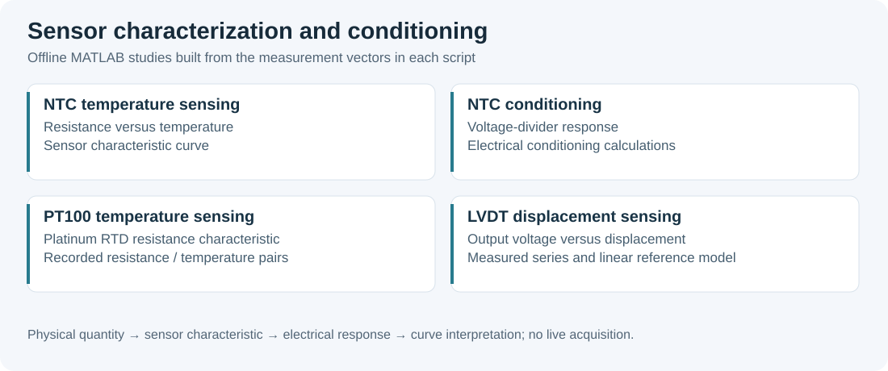

# Industrial Sensor Labs

Experimental characterization and signal conditioning of NTC thermistors, Pt100 resistance temperature detectors, an LVDT-based pressure transmitter and a strain-gauge force sensor. Original laboratory reports document the setups and measured series; MATLAB scripts plot the temperature and pressure characteristics.



## Studies

| Study | Measurement and conditioning | Report | MATLAB source |
| --- | --- | --- | --- |
| NTC thermistor (CTN) | Resistance versus temperature, heating/cooling curves and two voltage-divider configurations | [NTC report](docs/ntc_thermistor_report.pdf) | [Resistance](src/ctn_resistance_temperature.m), [divider](src/ctn_pont_diviseur.m), [conditioning](src/ctn_conditionnement.m) |
| Pt100 | Resistance measurements from 16 to 110 °C, characteristic slope, reference-table comparison and a four-stage op-amp conditioner including a Howland current source | [Pt100 report](docs/pt100_temperature_sensor_report.pdf) | [Resistance characteristic](src/pt100_resistance_temperature.m) |
| LVDT pressure transmitter | Six increasing-pressure series over 0–1 bar, a descending-pressure series and reference-manometer comparison | [LVDT pressure report](docs/lvdt_pressure_sensor_report.pdf) | [Pressure characteristic](src/lvdt_caracteristique.m) |
| Strain-gauge force sensor | Two strain gauges, Wheatstone bridge, amplifier and output-voltage measurements under applied masses from 0 to 1600 g | [Force report](docs/force_sensor_report.pdf) | Measurement tables and setup diagram in the report |

The LVDT converts mechanical displacement into an electrical signal; in this bench the calibrated input is **pressure**, expressed in bar. The MATLAB variable `p` represents pressure, not displacement. The force experiment shows an approximately proportional region at low loads and a progressively flattening output at higher loads.

## Measurement principles

- An NTC thermistor is a semiconductor temperature sensor with decreasing resistance as temperature increases. Its beta model uses absolute temperature in kelvin: `R(T) = R0 * exp(B * (1/T - 1/T0))`. It is distinct from the platinum RTD used in the Pt100 study.
- Pt100 denotes a platinum resistance of 100 ohms at 0 °C. The report combines resistance calibration with current excitation, amplification, offset adjustment and a nominal conditioner scale of 0 V at 0 °C and 1 V at 100 °C.
- For the LVDT bench, the measured chain is pressure → mechanical displacement → differential inductive response → conditioned voltage. The repeated increasing-pressure series support a repeatability comparison; the descending series provides a separate hysteresis comparison after its units are reconciled.
- Strain changes gauge resistance and unbalances the Wheatstone bridge. Convert the applied mass to kilograms before computing force: `F = m * g`, with `g` approximately 9.81 m/s².

## Run a study

Open a script in MATLAB and run it independently, for example:

```matlab
run('src/pt100_resistance_temperature.m')
run('src/lvdt_caracteristique.m')
```

The scripts use recorded measurement vectors rather than live device interfaces. In the original LVDT script, the final `plot` replaces the six measured curves with the reference line `11.2*p - 0.8`. Inspect both plotting calls when comparing the measured series and that reference; the reference coefficients are not a newly fitted least-squares result.

## Reading the original results

The PDFs preserve their original French text and group credits. The [alternative force report](docs/archive/force_sensor_alternative_version.pdf) contains the same recorded voltage series in a different layout; it is a source version rather than a second experiment. The two supplied CTN PDFs were byte-identical and are represented by a single report.

Use the physical units and circuit bounds when interpreting the historical tables. The force tables label values such as 490 for a 50 g load as newtons; the corresponding force is approximately **0.4905 N**, so those entries contain a factor-of-1000 unit error. The NTC report states a 5 V divider supply while listing some outputs above 5 V; a passive divider cannot exceed its supply. The Pt100 resistance-box temperature column is inconsistent with the report's own reference table, and the descending LVDT series has a different numerical scale from the increasing-voltage series. These entries remain visible in the originals and are not reused here as calibrated performance specifications.

## Related work

[Physical Instrumentation](https://github.com/tedjelmoulksn-dotcom/Instrumentation_Physique) includes sensor fabrication and optical measurements; [LabVIEW Instrumentation](https://github.com/tedjelmoulksn-dotcom/LabVIEW_Instrumentation) contains graphical acquisition exercises.
